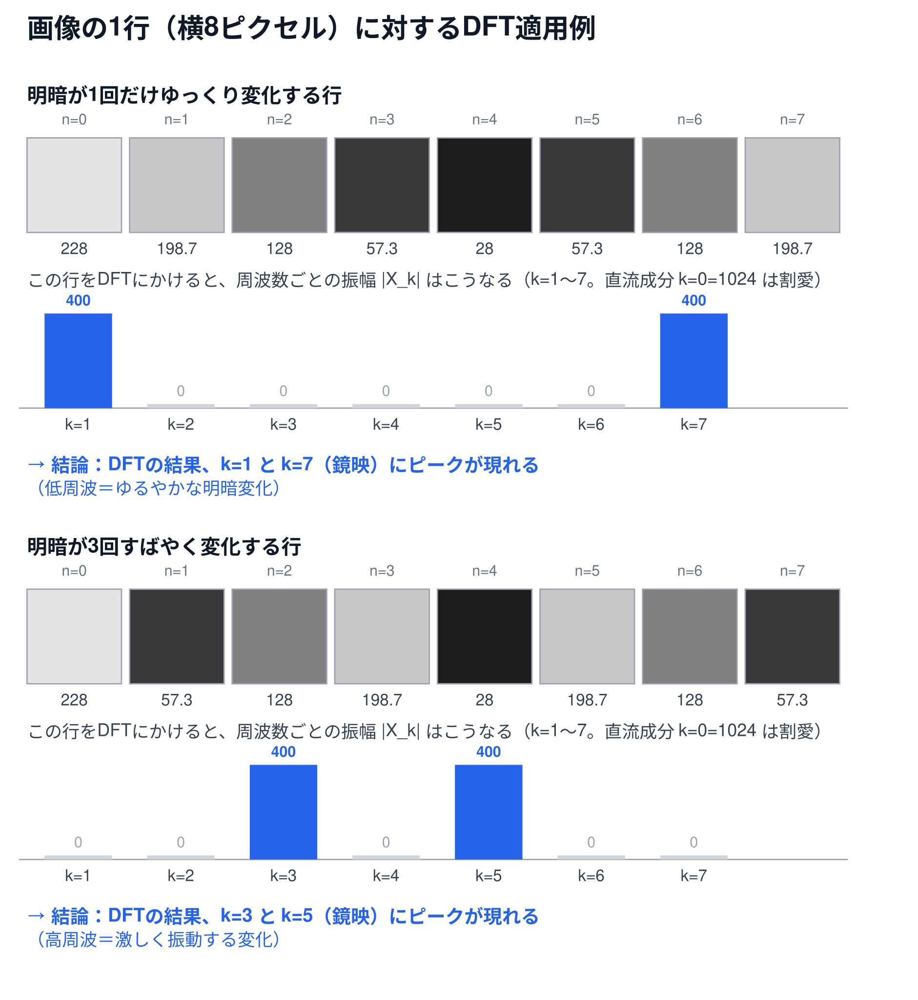

# 画像の1行に対するDFTの適用例（補足資料）

[← 6-1. 離散フーリエ変換（1次元）へ戻る](6-1-dft.md)

## 超ざっくり言うと

`N`サンプルの信号として、実際に「画像の1行分の輝度の並び」を使うと、`k`という周波数の添字が「その行の中で明暗が何回切り替わるか」に対応することが、グレースケールの帯として目で見て確認できる。

## 📊 画像の1行（横8ピクセル）とDFTの関係（図解）



横8ピクセルの行を2パターン用意し、実際の輝度値とDFTの振幅スペクトラムを並べて示した図。どちらの行も、主成分の周波数に加えて別の周波数が少し混ざっており、DFTの結果は「主成分に大きなピーク、混ざった成分に小さいが`0`ではないピーク」という段階的な形になる。

## 概念

[6-1本編](6-1-dft.md)の`N`サンプルという信号は、抽象的な数値の並びとして説明したが、画像処理の文脈での一番身近な具体例は**画像の1行分の輝度の並び**（横幅`W`ピクセルの行なら、`N=W`個の輝度値の配列）。この行に対してDFTを計算すると、「`k`番目の周波数の値がどれだけ含まれているか」が、「その行の中で明るさが何回上下するか」という、目に見える模様の性質に直接対応する（信号の個数`N`とDFTが返す周波数の個数が常に一致する理由は[補足資料](6-1-dft-wave-count.md)を参照）。

実際の画像の1行は、単一の周波数だけでできていることはまずない。エッジ・テクスチャ・なだらかな照明変化などが混ざり合っているため、DFTの結果も「主成分に大きな値、それ以外にも段階的な値」という形になるのが普通（`0`になることの方がむしろ珍しい——詳しくは[物差し（基準波）で信号を測るという見方](6-1-dft-ruler-analogy.md)を参照）。以下の例も、単一周波数ではなく「主成分＋少し混ざった成分」という、より現実に近い行で確認する。

## 具体的な計算例

横8ピクセルの行を2パターン作り、実際にDFTを計算して比較する。中心の明るさ`128`を基準に、主成分は振幅`80`、少し混ざる成分は振幅`20`で変化させる（`128 + 80・cos(2π・k_主・n/8) + 20・cos(2π・k_副・n/8)`）。

**パターンA：`k=1`が主成分、`k=3`が少し混ざる**

```
輝度の並び（丸めて表示）: [228, 170.4, 128, 85.6, 28, 85.6, 128, 170.4]
DFT振幅|X_k| (k=0〜7):   [1024, 320, 0, 80, 0, 80, 0, 320]
```

ゆるやかな明暗変化（`k=1`）が主成分で、そこにやや速い変化（`k=3`）が少しだけ混ざっている。DFTの結果は、`k=0`（直流成分、輝度の総和`1024`）を除くと、`k=1`とその鏡映`k=7`に振幅`320`の大きなピーク、`k=3`とその鏡映`k=5`にも振幅`80`の小さいピークが現れる——`k=3`は`0`ではない。

**パターンB：`k=3`が主成分、`k=1`が少し混ざる**

```
輝度の並び（丸めて表示）: [228, 85.6, 128, 170.4, 28, 170.4, 128, 85.6]
DFT振幅|X_k| (k=0〜7):   [1024, 80, 0, 320, 0, 320, 0, 80]
```

同じ2つの周波数成分でも、主従を入れ替えた行。速い変化（`k=3`）が主成分になり、ゆるやかな変化（`k=1`）が少しだけ混ざる。DFTの結果も主従が入れ替わり、`k=3`とその鏡映`k=5`に振幅`320`の大きなピーク、`k=1`とその鏡映`k=7`に振幅`80`の小さいピークが現れる。

## 読み取れること

`k`が大きいほど、その行の中で明暗がより速く・何度も切り替わる——画像で言えば**細かい模様やエッジ**に相当する。逆に`k`が小さい（`k=1`に近い）ほど、**ゆるやかなグラデーション**のような変化に相当する。これが、[6-1の概念欄](6-1-dft.md)で触れた「低周波＝ゆるやかな明暗変化」「高周波＝激しく振動する変化」という言葉の、画像での具体的な中身になる。

どちらのパターンも、`k=0`（直流成分）は輝度の総和（`1024`）に一致する。主成分（`320`）と、少し混ざった成分（`80`）のように、**値は「含まれる度合い」に応じて段階的になる**のが実際の画像に近い結果であり、厳密に`0`になるのは、信号にその周波数が全く含まれていない場合（上の例では`k=2,4,6`）に限られる。[6-1本編の単一周波数の例](6-1-dft.md)のように、単一の整数周期の信号で、かつ物差しの周波数がそれと完全にずれている場合にのみ厳密な`0`が保証される——詳しい仕組みは[物差し（基準波）で信号を測るという見方](6-1-dft-ruler-analogy.md)を参照。また、ここでは`k=1`・`k=3`という整数周期の成分だけを混ぜているが、もし中途半端な周期（例えば1.5回分）の変化が混ざると、ピークが1箇所に集中せず周囲の周波数にも値が漏れ出す（スペクトル漏れ, spectral leakageと呼ばれる現象）。

## 関連

- [6-1. 離散フーリエ変換（1次元）](6-1-dft.md) — `k`という周波数の添字の定義そのもの
- [波と周波数の基礎（補足資料）](6-1-dft-waves-and-frequency.md) — 振幅・周波数という言葉の意味
- [物差し（基準波）で信号を測るという見方（補足資料）](6-1-dft-ruler-analogy.md) — なぜ段階的な値になるのか、厳密に`0`になるのはどんな場合かを複素平面で図解
- [なぜ波の数と信号の配列の数が一致するか（補足資料）](6-1-dft-wave-count.md) — `N`個の信号から常に`N`個の周波数成分が得られる理由
