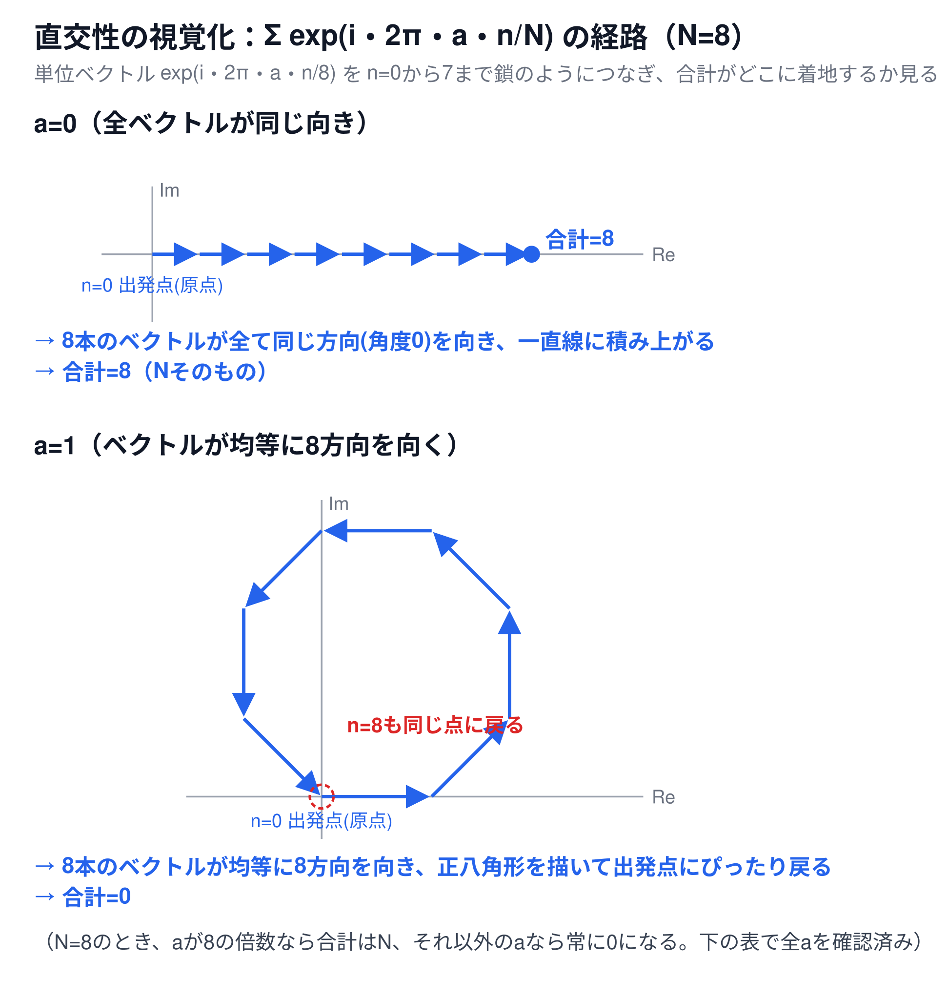

# 複素指数の直交性（補足資料）

[← 6-1. 離散フーリエ変換（1次元）へ戻る](6-1-dft.md)

## 超ざっくり言うと

単位円上を均等な角度で回転する複素数を、1周分すべて足し合わせると、ぴったり`0`になる——という性質。DFTとIDFTが正しく組み合わさって動く土台になっている、重要な数学的事実。

## 直交性とは何か

次の式を考える。

$$
\sum_{n=0}^{N-1} e^{i \cdot 2\pi a n / N}
$$

ここで`a`は、**特定の意味を持たない、ただの整数**（`0`, `1`, `-3`, `100`など、何でもよい）。この式は、`N`個の単位ベクトル`exp(i・2πan/N)`（`n=0`から`N-1`まで）を全部足し合わせる、というだけの計算になっている。

この式には、次の性質がある。

```
aがNの倍数のとき   → 合計はN
aがNの倍数でないとき → 合計は0
```

これが**複素指数の直交性**と呼ばれる性質。`a`に何を当てはめるかは、使う場面によって変わる（後述の「応用」を参照）。ここではまず、`a`を特定の文脈と結びつけず、**この式単体の性質**として理解する。

## 📊 図で確認する



`N=8`で、単位ベクトル`exp(i・2π・a・n/8)`を`n=0`から`7`まで鎖のようにつないだ図。

- **`a=0`のとき**：どの`n`でも`exp(0)=1`なので、8本のベクトルが全て同じ方向（角度`0`）を向く。鎖は一直線に積み上がり、合計は`N=8`になる
- **`a=1`のとき**：8本のベクトルが均等に8方向（`45`度ずつ）を向く。鎖は正八角形を描き、最後に出発点（原点）へぴったり戻ってくる。向きがバラバラな分だけ打ち消し合い、合計は`0`になる

## なぜこうなるのか（幾何学的な直感）

- **`a`が`N`の倍数のとき**：1ステップあたりの回転角`2πa/N`が`2π`の整数倍になり、`exp(i・2πan/N)`は`n`によらず常に同じ値（`1`）になる。同じ向きのベクトルを`N`本足すので、合計は`N`
- **`a`が`N`の倍数でないとき**：`N`本のベクトルは、単位円上を均等な角度間隔で、ちょうど1周分（またはその整数倍）だけ分散して並ぶ。円周上に均等に配置されたベクトルは、互いに向きが打ち消し合うように対称に分布しているため、合計すると必ず`0`になる

## 表で確認する

`N=8`で、`a`をいろいろ変えて実際に計算すると、`a`が`8`の倍数のときだけ合計が`8`になり、それ以外は全て`0`になることが確認できる。

| `a` | `Σ exp(i・2π・a・n/8)` |
|---|---|
| -3 | `0` |
| -2 | `0` |
| -1 | `0` |
| **0** | **`8`** |
| 1 | `0` |
| 2 | `0` |
| 3 | `0` |
| 4 | `0` |
| 5 | `0` |
| 6 | `0` |
| 7 | `0` |
| **8** | **`8`** |

## 応用：DFTとIDFTの符号が逆である理由

ここから先は、直交性が実際にDFTの仕組みの中でどう使われるかの一例。[6-1本編](6-1-dft.md)のDFTと[6-2のIDFT](6-2-idft.md)は、次のように指数の符号が逆になっている。

```
DFT:  X_k = Σ_n x_n・exp(-2πikn/N)
IDFT: x_n = (1/N)Σ_k X_k・exp(+2πikn/N)
```

IDFTの式は「`+`符号の物差しを使った波を、重み`X_k`で混ぜ合わせる」という**合成**の操作になっている。この`x_n`から、特定の周波数`X_k`だけを正しく取り出す（**分析**の操作）には、合成で使った物差しと**符号が逆**の物差しを掛けて全部足す必要がある。

試しに、IDFTの式をDFTの式にそのまま代入する。式が長くなるのを避けるため、IDFTの中で全周波数を足し合わせるための添字を`k'`（固定された`k`と区別するための記号）とする。

$$
\sum_{n=0}^{N-1} x_n \cdot e^{-2\pi i k n / N} = \sum_{n=0}^{N-1} \left( \frac{1}{N} \sum_{k'=0}^{N-1} X_{k'} e^{2\pi i k' n / N} \right) e^{-2\pi i k n / N}
$$

`n`についての和と`k'`についての和の順番を入れ替えて整理すると、指数の肩が`k'-k`の形にまとまる。

$$
= \frac{1}{N} \sum_{k'=0}^{N-1} X_{k'} \sum_{n=0}^{N-1} e^{2\pi i (k'-k) n / N}
$$

内側の`Σ`は、まさに上で確認した直交性の式に、`a = k'-k`を当てはめたものになっている。`k'=k`のときだけ`N`になり、それ以外は`0`になるので、`k'`についての和はただ1項（`k'=k`の項）だけが生き残る。

$$
= \frac{1}{N} \cdot X_k \cdot N = X_k
$$

こうして、`DFT(IDFT(X)) = X`が正しく成り立つ。**この計算が成立するのは、DFTの指数の符号がIDFTと逆だから**。もしDFTもIDFTと同じ`+`符号を使っていたら、指数の肩は`k'-k`ではなく`k'+k`になり、直交性の条件（`a`が`N`の倍数になる）を満たすのは`k'=-k mod N`のときだけになってしまう。つまり`X_k`ではなく`X_{-k mod N}`（添字が裏返ったもの）が返ってきてしまう。

実際に試してみると、この通りの結果になることが確認できる（`N=8`、ランダムな複素数の周波数成分`X`を使用）。

```
元のX:              [ 0.126-0.704j -0.132-1.265j  0.64 -0.623j  0.105+0.041j -0.536-2.325j  0.362-0.219j  1.304-1.246j  0.947-0.732j]
逆符号(-)で復元:     [ 0.126-0.704j -0.132-1.265j  0.64 -0.623j  0.105+0.041j -0.536-2.325j  0.362-0.219j  1.304-1.246j  0.947-0.732j]  ← 元のXと完全一致
同じ符号(+)で復元:   [ 0.126-0.704j  0.947-0.732j  1.304-1.246j  0.362-0.219j -0.536-2.325j  0.105+0.041j  0.64 -0.623j -0.132-1.265j]  ← X[-k mod 8]と一致（添字が裏返る）
```

つまり、**DFTとIDFTが逆符号であること自体は、直交性から数学的に必然**。一方で「どちらが`-`でどちらが`+`か」は、信号処理分野で広く使われている**慣習**（両方を入れ替えても、整合性さえ取れていれば理論上は成立する）。

## 関連

- [6-1. 離散フーリエ変換（1次元）](6-1-dft.md) — `(式1)`の定義式そのもの
- [なぜ`-2πikn/N`という形になるのか（補足資料）](6-1-dft-exponent-derivation.md) — 指数の「大きさ」の理由。この資料は「符号」の理由を担当
- [物差し（基準波）で信号を測るという見方（補足資料）](6-1-dft-ruler-analogy.md) — 直交性を使った、信号の打ち消し合いの具体例
- [なぜ波の数と信号の配列の数が一致するか（補足資料）](6-1-dft-wave-count.md) — 同じ直交性から導かれる、別の帰結
- [6-2. 逆離散フーリエ変換（1次元）](6-2-idft.md) — この資料で使った合成の式`x_n = (1/N)Σ X_k・exp(+2πikn/N)`
