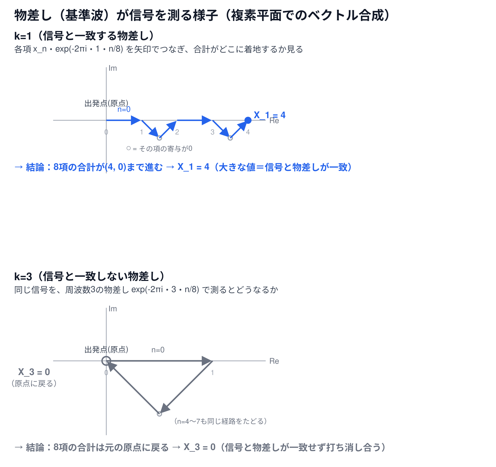

# 物差し（基準波）で信号を測るという見方（補足資料）

[← 6-1. 離散フーリエ変換（1次元）へ戻る](6-1-dft.md)

## 超ざっくり言うと

[(式1)](6-1-dft.md)の`exp(-2πikn/N)`は、信号の値とは無関係に`k`と`n`だけで先に決まる「物差し（基準波）」。DFTは、信号の各点をこの物差しに掛けて複素平面上のベクトルとして足し合わせ、「信号がこの物差しとどれだけ似ているか」を測る操作になっている。

## 📊 物差しが信号を測る様子（図解）



`N=8`の余弦波信号`x_n = cos(2πn/8)`を例に、周波数`k=1`（信号と一致する物差し）と`k=3`（一致しない物差し）それぞれで、8つの項`x_n・exp(-2πikn/N)`を複素平面上のベクトルとして矢印でつなげた図。

## 概念

[6-1本編](6-1-dft.md)の[(式1)](6-1-dft.md)`X_k = Σ x_n・exp(-2πikn/N)`をもう一度見ると、`exp(-2πikn/N)`の部分には、信号の値`x_n`が一切登場しない。この部分は、[複素平面の単位円](6-1-dft-complex-numbers.md)上を、`k`と`n`だけで決まる角度だけ回転させた点——いわば**「周波数`k`を測るための物差し」**を、先に`n=0`から`N-1`まで用意しているだけ。

DFTは、この物差しの各目盛り`exp(-2πikn/N)`に、信号の値`x_n`を掛けて（物差しをその分だけ伸び縮みさせて）、`N`個のベクトルとして複素平面上に並べ、それを全部足し合わせる。信号が物差しの周波数と**似ているほど、ベクトルは同じような向きを向いて足し合わさり、大きな合計**になる。似ていなければ、ベクトルはバラバラな方向を向き、**足し合わせると打ち消し合って小さく（0に近く）**なる。

## 具体的な計算例

`N=8`の信号`x_n = cos(2πn/8)`（[6-1本編の数値例](6-1-dft.md)と同じ信号）で、`k=1`と`k=3`の2つの物差しを比較する。

**`k=1`（信号と一致する物差し）**：各項`x_n・exp(-2πi・1・n/8)`を計算すると

```
n=0: x_n=+1.0000, 物差し(角度   0度)=1.0000+0.0000j, 項=1.0000+0.0000j
n=1: x_n=+0.7071, 物差し(角度 -45度)=0.7071-0.7071j, 項=0.5000-0.5000j
n=2: x_n=+0.0000, 物差し(角度 -90度)=0.0000-1.0000j, 項=0.0000+0.0000j
n=3: x_n=-0.7071, 物差し(角度-135度)=-0.7071-0.7071j, 項=0.5000+0.5000j
n=4: x_n=-1.0000, 物差し(角度-180度)=-1.0000+0.0000j, 項=1.0000+0.0000j
n=5: x_n=-0.7071, 物差し(角度-225度)=-0.7071+0.7071j, 項=0.5000-0.5000j
n=6: x_n=-0.0000, 物差し(角度-270度)=0.0000+1.0000j, 項=0.0000+0.0000j
n=7: x_n=+0.7071, 物差し(角度-315度)=0.7071+0.7071j, 項=0.5000+0.5000j
合計 X_1 = 4+0j
```

上の図（k=1パネル）は、この8つの「項」を矢印として順につなげたもの。信号が物差しと一致しているため、ベクトルは全体として右方向（実軸のプラス方向）に積み上がっていき、最終的に`(4, 0)`に到達する。

**`k=3`（信号と一致しない物差し）**：同じ信号を、周波数3の物差しで測ると

```
合計 X_3 = 0+0j
```

図（k=3パネル）を見ると、8つのベクトルが三角形を描くように進み、最終的に出発点（原点）にぴったり戻ってくる。`n=4〜7`の4項は、信号の対称性により`n=0〜3`と全く同じベクトルの並びを繰り返すため、同じ三角形の経路をもう一周する形になる。向きがバラバラなベクトルを足し合わせた結果、打ち消し合って合計が`0`になる。

## 関連

- [6-1. 離散フーリエ変換（1次元）](6-1-dft.md) — `(式1)`の定義式そのもの
- [複素数とは（補足資料）](6-1-dft-complex-numbers.md) — 複素数を複素平面上の矢印として捉える視点
- [オイラーの公式（補足資料）](6-1-dft-euler-formula.md) — `exp(-2πikn/N)`が単位円上の回転であることの根拠
