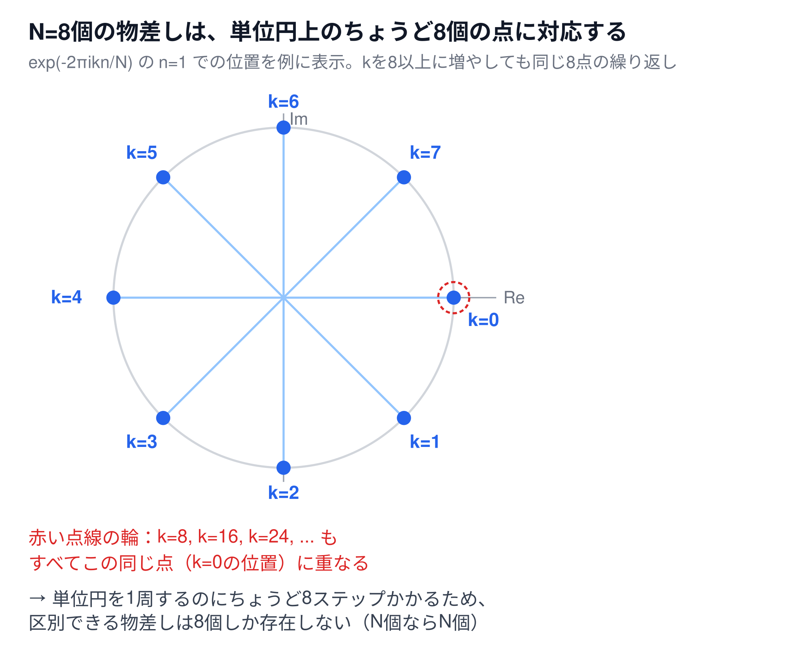

# なぜ波の数と信号の配列の数が一致するか（補足資料）

[← 6-1. 離散フーリエ変換（1次元）へ戻る](6-1-dft.md)

## 超ざっくり言うと

長さ`N`の信号を[DFT](6-1-dft.md)にかけると、必ずちょうど`N`個の周波数成分（`X_0`から`X_{N-1}`）が返ってくる。これは偶然の一致ではなく、「物差し`exp(-2πikn/N)`には`N`種類しか存在しない」という周期性と、「`N`個の数値は`N`次元の空間の点である」という線形代数の事実、この2つから必然的に導かれる結果。

## 📊 物差しの周期性（図解）



`exp(-2πikn/N)`を複素平面上の点として`k=0`から順に並べていくと、単位円上をちょうど`N`等分した点を巡る。`k=N`まで来ると、ぴったり1周して`k=0`と同じ点に戻ってしまう。

## 理由1：物差し自体が`N`種類しかない（周期性）

[6-1本編](6-1-dft.md)の物差し`exp(-2πikn/N)`で、`k`の代わりに`k+N`を代入すると

$$
e^{-2\pi i (k+N) n / N} = e^{-2\pi i k n / N} \cdot e^{-2\pi i n}
$$

`n`は整数なので、`exp(-2πin)`は単位円をちょうど`n`回転して元の位置に戻り、常に`1`になる（下記の表で実際に検証済み）。つまり

$$
e^{-2\pi i (k+N) n / N} = e^{-2\pi i k n / N}
$$

となり、**`k`と`k+N`の物差しは完全に同じもの**になる。`N=8`で実際に比較すると、次の表の通り1つ残らず一致する（`n=1`での値を代表例として計算）。

| `k` | `exp(-2πikn/N)`（`n=1`） | `exp(-2πi(k+8)n/N)`（`n=1`） | 一致 |
|---|---|---|---|
| 0 | `1.0000+0.0000j` | `1.0000+0.0000j` | ✅ |
| 1 | `0.7071-0.7071j` | `0.7071-0.7071j` | ✅ |
| 2 | `0.0000-1.0000j` | `0.0000-1.0000j` | ✅ |
| 3 | `-0.7071-0.7071j` | `-0.7071-0.7071j` | ✅ |
| 4 | `-1.0000-0.0000j` | `-1.0000-0.0000j` | ✅ |
| 5 | `-0.7071+0.7071j` | `-0.7071+0.7071j` | ✅ |
| 6 | `-0.0000+1.0000j` | `-0.0000+1.0000j` | ✅ |
| 7 | `0.7071+0.7071j` | `0.7071+0.7071j` | ✅ |

`k=8`以降は、`k=0`から`7`までの物差しの**使い回し**でしかない。だから「意味のある、互いに異なる物差し」は`k=0`から`N-1`までの`N`個しか存在せず、DFTの定義（[(式1)](6-1-dft.md)）も`k=0,...,N-1`の範囲に限定されている。

## 理由2：`N`個の数値は`N`次元の空間の点である（線形代数）

周期性だけでも「`N`種類より多くの物差しは無意味」ということは分かるが、「`N`種類**未満**では足りない」ことまでは説明できない。これを説明するのが線形代数の視点。

長さ`N`の信号`x_0, x_1, ..., x_{N-1}`は、`N`次元空間の1つの点（ベクトル）とみなせる。DFTは、この空間を眺める**座標軸を取り替える**操作——具体的には、「信号を1つ右にずらす」という巡回シフト操作の**固有ベクトル**を新しい座標軸として採用する操作になっている。

### 巡回シフト行列とその固有ベクトル

`N=4`の小さい例で具体的に確認する（`N`がいくつでも同じ構造になる）。信号を1つ右にずらす操作（末尾は先頭に戻る）は、次の行列`S`で表せる。

```
S =
⎡0 0 0 1⎤
⎢1 0 0 0⎥
⎢0 1 0 0⎥
⎣0 0 1 0⎦
```

DFTの物差しから作ったベクトル`v_k = (1, ω^k, ω^2k, ω^3k)`（`ω=exp(2πi/4)`）を、この`S`にかけると

$$
S v_k = \lambda_k v_k
$$

という**固有ベクトルの関係式**が成り立つ（`λ_k`は固有値）。この式は「左辺（`S v_k`：`S`を実際にかけた結果）」と「右辺（`λ_k v_k`：固有値`λ_k`を`v_k`の各成分に掛けた結果）」が一致する、という主張になっている。実際に`N=4`の4つの`k`すべてで両辺を計算すると、次のようにきれいに一致する。

| `k` | `v_k`（固有ベクトル） | `λ_k = exp(-2πik/N)`（固有値） | `λ_k v_k`（右辺） | `S v_k`（左辺） | 一致 |
|---|---|---|---|---|---|
| 0 | `(1, 1, 1, 1)` | `1` | `(1, 1, 1, 1)` | `(1, 1, 1, 1)` | ✅ |
| 1 | `(1, i, -1, -i)` | `-i` | `(-i, 1, i, -1)` | `(-i, 1, i, -1)` | ✅ |
| 2 | `(1, -1, 1, -1)` | `-1` | `(-1, 1, -1, 1)` | `(-1, 1, -1, 1)` | ✅ |
| 3 | `(1, -i, -1, i)` | `i` | `(i, 1, -i, -1)` | `(i, 1, -i, -1)` | ✅ |

（`λ_k v_k`と`S v_k`、それぞれ実際にnumpyで計算して一致を確認済み）

### なぜ`N`個の固有ベクトルがちょうど揃うのか

`S`は`N×N`の行列であり、信号が住んでいる空間はちょうど`N`次元。`S`は「回転」のような性質を持つ特別な行列（専門的には**ユニタリ行列**）で、ユニタリ行列は常に**次元の数だけ、互いに直交する固有ベクトルを持つ**という性質がある。つまり

| 概念 | 個数 |
|---|---|
| 信号が住む空間の次元 | `N` |
| 巡回シフト行列`S`の固有ベクトルの数 | `N`（必ず一致） |
| その固有ベクトルを使うDFTの出力（周波数成分）の数 | `N`（固有ベクトルと1対1対応） |

固有ベクトルが`N`個ちょうど揃って初めて、空間全体を過不足なく表現できる座標系になる。`N`個より少なければ空間の一部しか表現できず（信号を復元できない）、`N`個より多くは存在しようがない（理由1の周期性により、`N`個を超えた物差しは重複でしかない）。[6-2のIDFT](6-2-idft.md)がDFTの結果から元の信号をぴったり復元できるのも、この「`N`個↔`N`個」の過不足ない対応関係があるから。

## まとめ：信号`x_n`と周波数成分`X_k`は1対1で対応する

```
x_0  x_1  x_2  ...  x_{N-1}     （N個の信号サンプル）
 ↕    ↕    ↕          ↕
X_0  X_1  X_2  ...  X_{N-1}     （N個の周波数成分）
```

この対応がずれることはなく、常に「`N`個の信号」↔「`N`個の周波数成分」という1対1の変換になる。

## 関連

- [6-1. 離散フーリエ変換（1次元）](6-1-dft.md) — `k=0,...,N-1`という定義の根拠
- [画像の1行に対するDFTの適用例（補足資料）](6-1-dft-image-row-example.md) — `N=8`ピクセルの行から`8`個の周波数成分が得られる具体例
- [物差し（基準波）で信号を測るという見方（補足資料）](6-1-dft-ruler-analogy.md) — 物差し`exp(-2πikn/N)`そのものの図解
- [オイラーの公式（補足資料）](6-1-dft-euler-formula.md) — `exp(-2πin)=1`となる根拠
- [6-2. 逆離散フーリエ変換（1次元）](6-2-idft.md) — `N`個↔`N`個の対応関係があるからこそ、DFT→IDFTで元の信号にぴったり戻る
