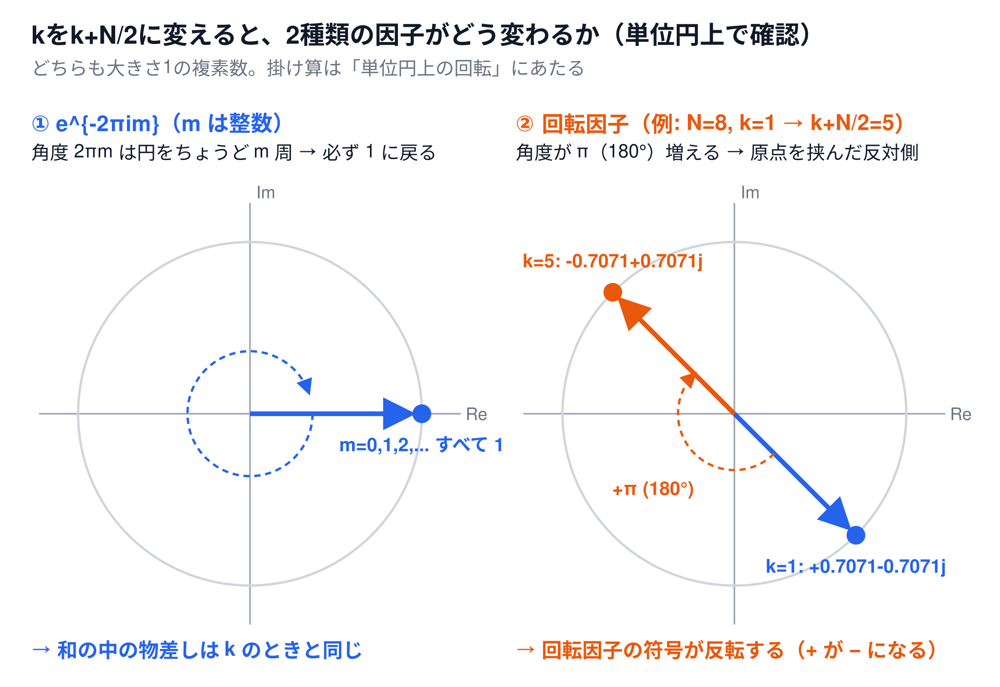

# バタフライ演算の式を導出する（補足資料）

[← なぜバタフライ演算が正しいのか（補足資料）へ戻る](6-6-fft-butterfly-why.md)

## 超ざっくり言うと

[6-6本編](6-6-fft.md)のバタフライ演算の2つの式は、どちらもDFTの定義式を書き換えるだけで導ける。この資料では、次の4ステップで1行ずつ式を追う。

1. 元のDFTの式
2. `X_k`の式（偶数番目・奇数番目に分けて、`E_k`・`O_k`を使った形にする）
3. `k`に`k+N/2`を代入した式（DFTの定義のまま。バタフライ演算はまだ使わない）
4. 3の右辺が、バタフライ演算の式`E_k - O_k e^{-2πik/N}`と等しくなることの証明

## 記号の整理

| 記号 | 意味 |
|---|---|
| `N` | 信号の長さ（偶数） |
| `x_n` | 元の信号の`n`番目のサンプル（`n = 0, ..., N-1`） |
| `X_k` | 元の信号のDFTの`k`番目の値 |
| `m` | 偶数番目・奇数番目の部分信号の中での番号（`m = 0, ..., N/2-1`） |
| `E_k` | 偶数番目の部分信号`x_0, x_2, x_4, ...`を、長さ`N/2`の信号としてDFTした結果 |
| `O_k` | 奇数番目の部分信号`x_1, x_3, x_5, ...`を、長さ`N/2`の信号としてDFTした結果 |

## ステップ1：元のDFTの式

出発点は、[6-1](6-1-dft.md)のDFTの定義式。

$$
X_k = \sum_{n=0}^{N-1} x_n e^{-2\pi i k n / N}
$$

和の中の`e^{-2πikn/N}`が「`k`番目の物差し」。[オイラーの公式](6-1-dft-euler-formula.md)で三角関数に直す。

**オイラーの公式**（角度にマイナスが付いた形。`cos(-θ) = cos(θ)`、`sin(-θ) = -sin(θ)`より）：

$$
e^{-i\theta} = \cos(\theta) - i \sin(\theta)
$$

`θ = 2πkn/N`を当てはめると、次のようになる。

$$
e^{-2\pi i k n / N} = \cos(2\pi k n / N) - i \sin(2\pi k n / N)
$$

## ステップ2：`X_k`の式（`E_k`・`O_k`を使った形）

### 2-1. 和を偶数番目と奇数番目に分ける


`n`を、偶数`n = 2m`と奇数`n = 2m+1`に分けて書き直す。有限個の項の足し算は順番を入れ替えても結果が同じなので、この変形はいつでもできる。

$$
X_k = \sum_{m=0}^{N/2-1} x_{2m} e^{-2\pi i k (2m) / N} + \sum_{m=0}^{N/2-1} x_{2m+1} e^{-2\pi i k (2m+1) / N}
$$

### 2-2. 物差しの指数を整理する

偶数番目の物差しは、`2m/N = m/(N/2)`なので、長さ`N/2`のDFTの物差しと同じ形になる。

$$
e^{-2\pi i k (2m) / N} = e^{-2\pi i k m / (N/2)}
$$

奇数番目の物差しは、指数法則`e^{a+b} = e^a・e^b`で、`2m+1`の`+1`の部分を別の因子として分けられる。

$$
e^{-2\pi i k (2m+1) / N} = e^{-2\pi i k m / (N/2)} \cdot e^{-2\pi i k / N}
$$

### 2-3. 共通因数をくくり出す

`e^{-2πik/N}`は`m`を含まない（どの奇数番目のサンプルでも同じ値）ので、分配法則で和の外にくくり出せる。

$$
X_k = \sum_{m=0}^{N/2-1} x_{2m} e^{-2\pi i k m / (N/2)} + e^{-2\pi i k / N} \sum_{m=0}^{N/2-1} x_{2m+1} e^{-2\pi i k m / (N/2)}
$$

2つの和は、それぞれ「長さ`N/2`の偶数番目の信号のDFT」と「長さ`N/2`の奇数番目の信号のDFT」の定義そのもの。この2つに、`E_k`・`O_k`という名前を付ける。

$$
E_k = \sum_{m=0}^{N/2-1} x_{2m} e^{-2\pi i k m / (N/2)}
$$

$$
O_k = \sum_{m=0}^{N/2-1} x_{2m+1} e^{-2\pi i k m / (N/2)}
$$

上の式の1つ目の和を`E_k`、2つ目の和を`O_k`に置き換えると、バタフライ演算の1つ目の式が得られる。

$$
X_k = E_k + O_k e^{-2\pi i k / N}
$$

`O_k`に掛かっている`e^{-2πik/N}`が回転因子。上の図のとおり、奇数番目のサンプル`x_{2m+1}`は、同じ`m`の偶数番目`x_{2m}`より元の信号で1つ後ろにある。そのずれが、この因子として現れている。

## ステップ3：`k`に`k+N/2`を代入した式（バタフライ演算を使わない）

DFTの定義式（ステップ1）の`k`に、そのまま`k+N/2`を代入する。

$$
X_{k+N/2} = \sum_{n=0}^{N-1} x_n e^{-2\pi i (k+N/2) n / N}
$$

これは「`k+N/2`番目の物差しで測った値」をDFTの定義どおりに書いただけの式で、`E_k`・`O_k`はまだ出てこない。ここから、この右辺が次のバタフライ演算の式と等しくなることを示す。

$$
X_{k+N/2} = E_k - O_k e^{-2\pi i k / N}
$$

## ステップ4：ステップ3の右辺がバタフライ演算の式と等しいことの証明

### 4-1. 和を偶数番目と奇数番目に分ける

ステップ3の式は、`n = 0, 1, ..., N-1`の`N`個の項を足し合わせたもの。ステップ2-1と同じように、この`N`個の項を偶数番目と奇数番目の2つのグループに分けて、別々に足す。

- **偶数番目の項**：`n = 2m`と書ける。`m = 0, 1, ..., N/2-1`と動かすと、`n = 0, 2, 4, ..., N-2`をちょうど1回ずつ通る
- **奇数番目の項**：`n = 2m+1`と書ける。`m = 0, 1, ..., N/2-1`と動かすと、`n = 1, 3, 5, ..., N-1`をちょうど1回ずつ通る

```
N=8の場合:
偶数番目: m = 0, 1, 2, 3  →  n = 2m   = 0, 2, 4, 6
奇数番目: m = 0, 1, 2, 3  →  n = 2m+1 = 1, 3, 5, 7
→ 2つ合わせると n = 0〜7 の全8項を、漏れなく・重複なく1回ずつ数えている
```

どちらのグループも`m`は`0`から`N/2-1`まで動くので、和の範囲は`m=0`から`N/2-1`になる。それぞれのグループで、項の中の`n`（`x_n`の添字と、物差しの指数の中の`n`の両方）を、`2m`または`2m+1`に置き換える。

$$
X_{k+N/2} = \sum_{m=0}^{N/2-1} x_{2m} e^{-2\pi i (k+N/2)(2m) / N} + \sum_{m=0}^{N/2-1} x_{2m+1} e^{-2\pi i (k+N/2)(2m+1) / N}
$$

足す順番を入れ替えただけなので、値はステップ3の式と全く同じ。1つ目の和が偶数番目の項の合計、2つ目の和が奇数番目の項の合計にあたる。

ここから、偶数番目の物差しと奇数番目の物差しを、それぞれ整理する。



### 4-2. 偶数番目の物差しは`k`のときと変わらない

指数の中身`(k+N/2)(2m)/N`を展開する。まず分子の`(k+N/2)(2m)`をかっこを外して計算する（`(N/2)×2m = Nm`）。

$$
(k+N/2)(2m) = 2km + Nm
$$

これを`N`で割る。分子の各項をそれぞれ`N`で割ってよい。

$$
(k+N/2)(2m) / N = 2km / N + Nm / N
$$

1つ目の項`2km/N`は、分母と分子を`2`で割ると`km/(N/2)`になる（長さ`N/2`のDFTの物差しの形）。2つ目の項`Nm/N`は、`N`が約分されて`m`になる。

$$
(k+N/2)(2m) / N = k m / (N/2) + m
$$

指数法則`e^{a+b} = e^a・e^b`で、かけ算に分ける。

$$
e^{-2\pi i (k+N/2)(2m) / N} = e^{-2\pi i k m / (N/2)} \cdot e^{-2\pi i m}
$$

後ろの`e^{-2πim}`を、[オイラーの公式](6-1-dft-euler-formula.md)で三角関数に直す。

**オイラーの公式**（角度にマイナスが付いた形。`cos(-θ) = cos(θ)`、`sin(-θ) = -sin(θ)`より）：

$$
e^{-i\theta} = \cos(\theta) - i \sin(\theta)
$$

`θ = 2πm`を当てはめる。`m`は整数なので、角度`2πm`は円をちょうど`m`周した位置になり、`cos(2πm) = 1`、`sin(2πm) = 0`（上の図の①）。

$$
e^{-2\pi i m} = \cos(2\pi m) - i \sin(2\pi m) = 1 - i \cdot 0 = 1
$$

よって、偶数番目の物差しは`k`のときと全く同じになる。

$$
e^{-2\pi i (k+N/2)(2m) / N} = e^{-2\pi i k m / (N/2)}
$$

### 4-3. 奇数番目の物差しは符号が反転する

指数の中身`(k+N/2)(2m+1)/N`を展開する。まず分子の`(k+N/2)(2m+1)`をかっこを外して計算する。`k`と`N/2`のそれぞれに、`2m`と`1`を掛けて4つの項にする（`(N/2)×2m = Nm`、`(N/2)×1 = N/2`）。

$$
(k+N/2)(2m+1) = 2km + k + Nm + N/2
$$

これを`N`で割る。分子の各項をそれぞれ`N`で割る。

$$
(k+N/2)(2m+1) / N = 2km / N + k / N + Nm / N + (N/2) / N
$$

各項を整理する。

- `2km/N`：4-2と同じく、分母と分子を`2`で割って`km/(N/2)`
- `k/N`：このまま（これが回転因子の角度の部分）
- `Nm/N`：`N`が約分されて`m`
- `(N/2)/N`：`N`が約分されて`1/2`

$$
(k+N/2)(2m+1) / N = k m / (N/2) + k / N + m + 1/2
$$

4-2の結果（`km/(N/2) + m`）と比べやすいように、項の順番を並べ替えておく。

$$
(k+N/2)(2m+1) / N = k m / (N/2) + m + k / N + 1/2
$$

4-2の結果に、`k/N`と`1/2`の2項が加わった形になっている。全体に`-2πi`を掛けると、最後の項は`-2πi × 1/2 = -iπ`になる。指数法則で、4つのかけ算に分ける。

$$
e^{-2\pi i (k+N/2)(2m+1) / N} = e^{-2\pi i k m / (N/2)} \cdot e^{-2\pi i m} \cdot e^{-2\pi i k / N} \cdot e^{-i \pi}
$$

`e^{-2πim} = 1`は4-2で確認済み。残りの`e^{-iπ}`を、オイラーの公式で三角関数に直す。

**オイラーの公式**（ステップ1・4-2と同じ）：

$$
e^{-i\theta} = \cos(\theta) - i \sin(\theta)
$$

`θ = π`を当てはめる。`cos(π) = -1`、`sin(π) = 0`なので、次のようになる。

$$
e^{-i \pi} = \cos(\pi) - i \sin(\pi) = -1 - i \cdot 0 = -1
$$

よって、奇数番目の物差しは`k`のときの物差しに`-1`を掛けたもの（符号が反転したもの）になる。

$$
e^{-2\pi i (k+N/2)(2m+1) / N} = -e^{-2\pi i k m / (N/2)} \cdot e^{-2\pi i k / N}
$$

**三角関数の性質から見ても同じ**。`θ = 2πk/N`とおくと、`k`の回転因子は`e^{-iθ}`、`k+N/2`の回転因子は角度が`π`増えた`e^{-i(θ+π)}`になる。三角関数には「角度に`π`を足すと符号が反転する」という性質がある。

$$
\cos(\theta + \pi) = -\cos(\theta)
$$

$$
\sin(\theta + \pi) = -\sin(\theta)
$$

これを使うと、次のように書ける。

$$
e^{-i(\theta + \pi)} = \cos(\theta + \pi) - i \sin(\theta + \pi) = -\cos(\theta) + i \sin(\theta) = -e^{-i \theta}
$$

複素平面上では、角度を`π`（180°）進めることは、原点を挟んだちょうど反対側の点に移ることにあたる（上の図の②。`N=8`、`k=1`の回転因子`+0.7071-0.7071j`が、`k=5`では`-0.7071+0.7071j`になる）。

### 4-4. まとめて代入する

4-2・4-3の結果を4-1の式に代入する。奇数番目の和から出てくる`-e^{-2πik/N}`は`m`を含まないので、和の外にくくり出せる。

$$
X_{k+N/2} = \sum_{m=0}^{N/2-1} x_{2m} e^{-2\pi i k m / (N/2)} - e^{-2\pi i k / N} \sum_{m=0}^{N/2-1} x_{2m+1} e^{-2\pi i k m / (N/2)}
$$

1つ目の和はステップ2-3の`E_k`、2つ目の和は`O_k`の定義と全く同じ。それぞれを`E_k`・`O_k`に置き換えると、次の式が成り立つ。

$$
X_{k+N/2} = E_k - O_k e^{-2\pi i k / N}
$$

（証明終わり）

## `X_k`と`X_{k+N/2}`の比較

| | 偶数番目の物差し | 奇数番目の物差し（回転因子込み） | 結果 |
|---|---|---|---|
| `X_k` | `e^{-2πikm/(N/2)}` | `e^{-2πikm/(N/2)}・e^{-2πik/N}` | `E_k + O_k e^{-2πik/N}` |
| `X_{k+N/2}` | 同じ（`e^{-2πim} = 1`のため） | 符号が反転（`e^{-iπ} = -1`のため） | `E_k - O_k e^{-2πik/N}` |

[戻り先の資料](6-6-fft-butterfly-why.md)の「偶数番目では物差しが一致し、奇数番目では正反対を向く」という性質を、式の上で確かめたのがこの証明にあたる。

## 具体的な数値で確認する

`N=4`の信号`[1, 2, 3, 4]`、`k=1`（`k+N/2 = 3`）で確認する。

まず、ステップ3の式（DFTの定義どおり）で`X_3`を計算する。

```
n=0: x_0 × e^{-2πi・3・0/4} = 1 × (+1)   = 1      （偶数番目）
n=1: x_1 × e^{-2πi・3・1/4} = 2 × (+1j)  = 2j     （奇数番目）
n=2: x_2 × e^{-2πi・3・2/4} = 3 × (-1)   = -3     （偶数番目）
n=3: x_3 × e^{-2πi・3・3/4} = 4 × (-1j)  = -4j    （奇数番目）

X_3 = 1 + 2j - 3 - 4j = -2 - 2j
```

次に、バタフライ演算の式で計算する。

```
偶数番目 [1, 3] のDFT: E = [4, -2]   → E_1 = -2
奇数番目 [2, 4] のDFT: O = [6, -2]   → O_1 = -2
k=1の回転因子: e^{-2πi・1/4} = -1j

X_3 = E_1 - O_1 × (-1j) = -2 - (-2)×(-1j) = -2 - 2j
```

どちらも`-2 - 2j`で一致する（`np.fft.fft([1, 2, 3, 4])[3]`も`-2-2j`）。さらに項ごとに見ると、次のようになっている。

```
偶数番目の項の合計:  1 + (-3)   = -2   = E_1                        （4-2：物差しは k のときと同じ）
奇数番目の項の合計:  2j + (-4j) = -2j  = -O_1 × (-1j) = -(-2)×(-1j)  （4-3：符号が反転）
```

## 関連

- [なぜバタフライ演算が正しいのか（補足資料）](6-6-fft-butterfly-why.md) — 同じ性質を「物差しの比較」で直感的に説明したもの
- [6-6. 高速フーリエ変換（1次元）](6-6-fft.md) — バタフライ演算と回転因子が実際に使われる`fft_1d`
- [オイラーの公式（補足資料）](6-1-dft-euler-formula.md) — `e^{iθ} = cos(θ) + i・sin(θ)`の根拠
- [なぜ波の数と信号の配列の数が一致するか（補足資料）](6-1-dft-wave-count.md) — `e^{-2πim} = 1`と同じ、複素指数の周期性
