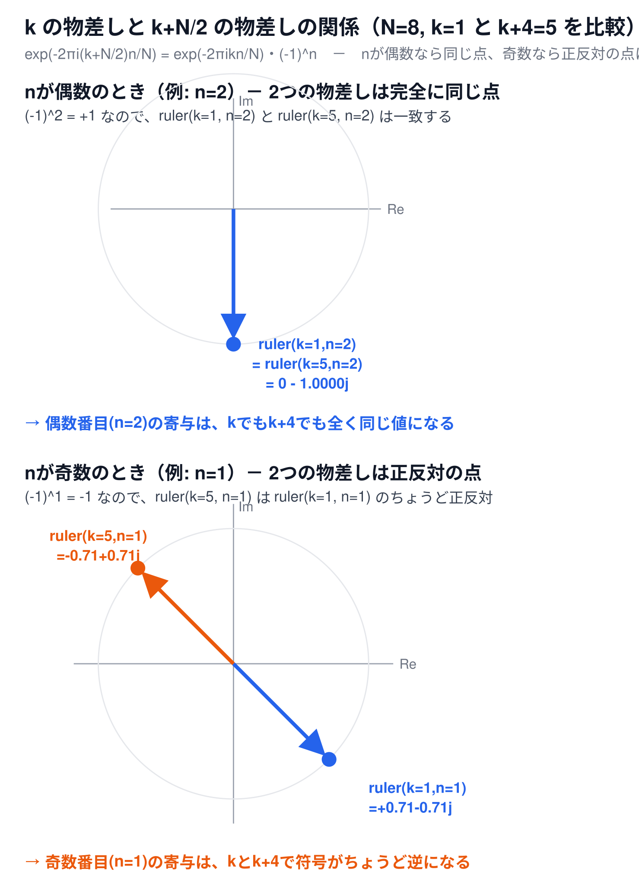

# なぜバタフライ演算が正しいのか（補足資料）

[← 6-6. 高速フーリエ変換（1次元）へ戻る](6-6-fft.md)

## 超ざっくり言うと

周波数`k`の物差しと、周波数`k+N/2`の物差しは、実はほとんど同じもの——**偶数番目のサンプルでは完全に一致し、奇数番目のサンプルでは正反対を向く**だけ。この性質のおかげで、2つの物差しの結果（`X_k`と`X_{k+N/2}`）を、同じ材料（`E_k`・`O_k`）の足し算・引き算だけで同時に求められる。

## `k`の物差しと`k+N/2`の物差しの関係

[6-6本編](6-6-fft.md)のバタフライ演算

$$
X_k = E_k + e^{-2\pi i k / N} O_k
$$

$$
X_{k+N/2} = E_k - e^{-2\pi i k / N} O_k
$$

が成り立つ根拠は、`k+N/2`番目の物差しの式を変形すると見えてくる。

$$
e^{-2\pi i (k+N/2) n / N} = e^{-2\pi i k n / N} \cdot e^{-i \pi n}
$$

`e^{-iπn}`は、`n`が整数のとき`(-1)^n`に等しい（[オイラーの公式](6-1-dft-euler-formula.md)より`e^{-iπ}=cos(π)-i・sin(π)=-1`、これを`n`乗すると`(-1)^n`）。つまり、

```
k+N/2番目の物差し = k番目の物差し × (-1)^n
```

**`n`が偶数なら`(-1)^n=+1`で物差しは変わらず、`n`が奇数なら`(-1)^n=-1`で物差しがちょうど反転する**。

## 📊 図で確認する



`N=8`、`k=1`と`k+4=5`を例に、具体的な`n`で確認する。

- **`n=2`（偶数）**：`ruler(k=1,n=2)`と`ruler(k=5,n=2)`は、複素平面上の**全く同じ点**（`0-1.0000j`）を指す
- **`n=1`（奇数）**：`ruler(k=1,n=1)`（`+0.71-0.71j`）と`ruler(k=5,n=1)`（`-0.71+0.71j`）は、原点を挟んで**ちょうど正反対の点**を指す

実際に`N=8`の全ての`n`で確認すると、次のようになる。

| `n` | `ruler(k=1,n)` | `ruler(k=5,n)` | 比率（`ruler(k+4,n) / ruler(k,n)`） |
|---|---|---|---|
| 0（偶） | +1.0000+0.0000j | +1.0000+0.0000j | +1.0 |
| 1（奇） | +0.7071-0.7071j | -0.7071+0.7071j | -1.0 |
| 2（偶） | +0.0000-1.0000j | +0.0000-1.0000j | +1.0 |
| 3（奇） | -0.7071-0.7071j | +0.7071+0.7071j | -1.0 |
| 4（偶） | -1.0000-0.0000j | -1.0000-0.0000j | +1.0 |
| 5（奇） | -0.7071+0.7071j | +0.7071-0.7071j | -1.0 |
| 6（偶） | -0.0000+1.0000j | -0.0000+1.0000j | +1.0 |
| 7（奇） | +0.7071+0.7071j | -0.7071-0.7071j | -1.0 |

偶数番目の`n`では比率が常に`+1`（完全に一致）、奇数番目の`n`では常に`-1`（正反対）になっている。

## これがバタフライ演算にどう繋がるか

`X_k`を「偶数番目からの寄与」と「奇数番目からの寄与」に分けて書くと、

```
X_k       = (偶数番目の寄与の合計) + (奇数番目の寄与の合計)
```

`k+N/2`番目では、偶数番目の寄与はそのまま（物差しが同じだから）、奇数番目の寄与だけ符号が反転する（物差しが`-1`倍だから）。

```
X_{k+N/2} = (偶数番目の寄与の合計) − (奇数番目の寄与の合計)
```

「偶数番目の寄与の合計」が`E_k`、「奇数番目の寄与の合計」が`exp(-2πik/N)・O_k`（[6-6本編](6-6-fft.md)で確認した通り、奇数番目の和には`exp(-2πik/N)`という共通因数がかかる）にあたる。つまり、

- **同じ材料（`E_k`・`O_k`）を1回ずつ用意すれば**、足せば`X_k`、引けば`X_{k+N/2}`が**両方とも**手に入る
- `X_k`と`X_{k+N/2}`を別々に最初から計算し直す必要はない

というのがバタフライ演算の正体。「`k`番目を測るのも`k+N/2`番目を測るのも、使う材料は全く同じで、奇数番目の寄与を足すか引くかだけが違う」という直感を、物差しの比較から直接確認できる。

## 関連

- [6-6. 高速フーリエ変換（1次元）](6-6-fft.md) — バタフライ演算の定義式そのもの
- [なぜ波の数と信号の配列の数が一致するか（補足資料）](6-1-dft-wave-count.md) — 物差しの周期性（`k`と`k+N`が同じ物差しになる性質）と同じ根っこの話
- [オイラーの公式（補足資料）](6-1-dft-euler-formula.md) — `e^{-iπ}=-1`の根拠
