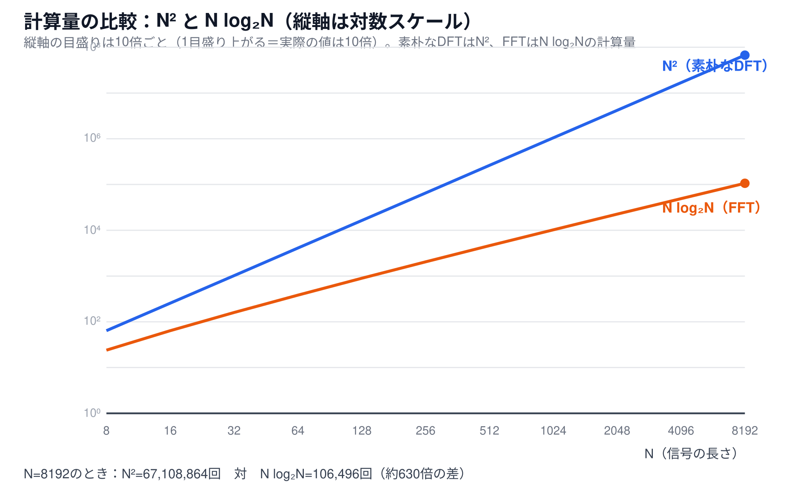

# 計算量（O記法）とは何か（補足資料）

[← 6-6. 高速フーリエ変換（1次元）へ戻る](6-6-fft.md)

## 超ざっくり言うと

「計算量」は、入力のサイズ`N`が大きくなったときに、処理に必要な手間（足し算・掛け算などの回数）が**どれくらいの勢いで増えていくか**を表す指標。`O(N²)`は「`N`の2乗に比例して増える」、`O(N log N)`は「`N`と`log N`の掛け算に比例して増える」という意味で、具体的な秒数やマシンの性能とは無関係に、**アルゴリズムそのものの効率**を比較するために使う。

## なぜ具体的な秒数ではなく「計算量」で比較するのか

同じアルゴリズムでも、実行するコンピュータの性能やプログラミング言語によって、かかる時間（秒数）は変わってしまう。しかし「入力が2倍になったら、手間は何倍になるか」という**増え方の勢い**は、コンピュータの性能に関係なく、アルゴリズムの構造だけで決まる。この「増え方の勢い」を表すのが計算量（`O`記法、オーダー記法）。[6-1のDFT](6-1-dft.md)は`O(N²)`、[6-6のFFT](6-6-fft.md)は`O(N log N)`——同じ結果を計算するのに、根本的に異なる勢いで手間が増えていく、ということを意味する。

## `O(N²)`と`O(N log N)`は具体的に何回なのか

`O(N²)`は「だいたい`N×N`回」、`O(N log N)`は「だいたい`N×log₂N`回」の計算が必要になる、という意味（`log₂N`は「`N`を`2`で何回割ったら`1`になるか」という回数。[6-6本編](6-6-fft.md)で確認した通り、FFTは信号を半分に割る操作を`log₂N`回繰り返す）。

実際に[`dft_1d`](6-1-dft.md)（`O(N²)`）と[`fft_1d`](6-6-fft.md)（`O(N log N)`）が行う掛け算の回数を、`N`を変えながら数えると、次のようになる。

| `N` | `N²`（dft_1dの掛け算回数） | `N log₂N`（fft_1dの掛け算回数の目安） | 比率 |
|---|---|---|---|
| 8 | 64 | 24 | 2.7倍 |
| 16 | 256 | 64 | 4.0倍 |
| 32 | 1,024 | 160 | 6.4倍 |
| 64 | 4,096 | 384 | 10.7倍 |
| 128 | 16,384 | 896 | 18.3倍 |
| 256 | 65,536 | 2,048 | 32.0倍 |
| 512 | 262,144 | 4,608 | 56.9倍 |
| 1,024 | 1,048,576 | 10,240 | 102.4倍 |
| 2,048 | 4,194,304 | 22,528 | 186.2倍 |
| 4,096 | 16,777,216 | 49,152 | 341.3倍 |
| 8,192 | 67,108,864 | 106,496 | 630.2倍 |

`N`が大きくなるほど、両者の差（比率）がどんどん開いていく——これが「計算量の違い」が実際の処理時間にもたらす影響の正体。

## 📊 グラフで確認する

縦軸は**対数スケール**（目盛りが1つ上がるごとに実際の値が10倍になる）で表示している。これは、`N²`と`N log N`の差があまりに大きく、普通の目盛り（等間隔）で描くと`N log N`の線がほぼ`0`に張り付いて見えなくなってしまうため。対数スケールで見ると、`N²`（青線）が`N log N`（オレンジ線）よりも急な角度で立ち上がっていく様子が分かる——この「角度の違い」こそが、2つのアルゴリズムの計算量の違いを表している。

## なぜ「`N`が2倍になると、`N²`は4倍、`N log N`は2倍強」なのか

[6-6本編](6-6-fft.md)に書いた「`N`が2倍になると`N²`は4倍になるが、`N log N`はおよそ2倍強にしかならない」を、具体的な数字で確認する。

**`N²`の場合**：`N`を`2N`にすると、

$$
(2N)^2 = 4N^2
$$

`N`に`2`を掛けると、2乗されるので必ず正確に`4`倍になる。

**`N log₂N`の場合**：`N`を`2N`にすると、

$$
(2N) \log_2(2N) = 2N (\log_2 N + 1)
$$

`log₂(2N) = log₂N + log₂2 = log₂N + 1`という対数の性質（[指数・対数の関係](6-1-dft-euler-formula.md)と同じ考え方）を使うと、`N log₂N`の**ちょうど`2`倍**に、さらに`2N`だけ余分に足された形になる。`N`が大きいほど、この「余分な`2N`」は全体（`2N log₂N`）に対して相対的に小さくなっていくため、倍率は`2`に近づいていくが、常に`2`より少しだけ大きい。

実際に計算すると、次のようになる。

| `N → 2N` | `N²`の倍率 | `N log₂N`の倍率 |
|---|---|---|
| 64 → 128 | 4.00倍 | 2.33倍 |
| 256 → 512 | 4.00倍 | 2.25倍 |
| 1,024 → 2,048 | 4.00倍 | 2.20倍 |
| 4,096 → 8,192 | 4.00倍 | 2.17倍 |

`N²`の倍率は常にきっちり`4.00`倍。`N log₂N`の倍率は、`N`が大きくなるほど`2`倍に近づいていく（`2.33倍→2.25倍→2.20倍→2.17倍`）が、常に`2`倍「強」——これが[6-6本編](6-6-fft.md)の「およそ2倍強にしかならない」という表現の具体的な中身。

## 関連

- [6-6. 高速フーリエ変換（1次元）](6-6-fft.md) — `O(N²)`から`O(N log N)`への高速化そのもの
- [なぜバタフライ演算が正しいのか（補足資料）](6-6-fft-butterfly-why.md) — 計算量が減る仕組みの直感的な根拠
