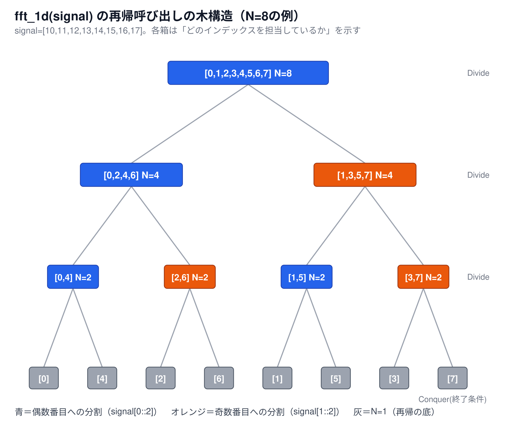

# 分割統治法：FFTが従う一般的なパターン（補足資料）

[← 6-6. 高速フーリエ変換（1次元）へ戻る](6-6-fft.md)

## 超ざっくり言うと

`fft_1d`の実装は、**分割統治法（Divide and Conquer）**という、再帰を使うアルゴリズムに共通する型（パターン）にそのまま当てはまる。この型は「①分割する→②同じ問題として再帰的に解く→③組み立て直す」という3ステップで、[6-6本編](6-6-fft.md)のコードの各部分も、この3ステップのどれかに対応している。

## 分割統治法の3ステップ

分割統治法は、次の3つのステップを持つアルゴリズムの設計パターン。

1. **分割（Divide）**：解きたい問題を、**同じ種類で、より小さい**複数の問題に分ける
2. **統治（Conquer）**：分割した小さい問題それぞれを、**同じ方法で再帰的に解く**（それ以上分割できない「十分小さい問題」になったら、直接答えを出す——これが再帰の終了条件）
3. **結合（Combine）**：小さい問題の答えを**組み合わせて**、元の問題の答えを作る

この3ステップのうち、②（統治）が「同じ方法で再帰的に解く」である点が核心——**分割した先でも、同じ分割統治のステップがもう一度適用される**ため、関数が自分自身を呼び出す「再帰」という形でコードに表れる。

## `fft_1d`での対応

[6-6本編の実装コード](6-6-fft.md)の各部分を、この3ステップに当てはめると、次のようになる。

| ステップ | `fft_1d`での対応箇所 | やっていること |
|---|---|---|
| ①分割（Divide） | `signal[0::2]`・`signal[1::2]` | 長さ`N`の信号を、偶数番目・奇数番目の、長さ`N/2`の2つの信号に分ける |
| ②統治（Conquer） | `even_part = fft_1d(signal[0::2])` `odd_part = fft_1d(signal[1::2])` | 分割した2つの信号それぞれに、`fft_1d`自身をもう一度適用する（再帰呼び出し） |
| （終了条件） | `if n_samples == 1: return signal.copy()` | これ以上分割できない「長さ1の信号」になったら、計算せずそのまま返す |
| ③結合（Combine） | `for k in range(half): ...`（バタフライ演算） | `even_part`・`odd_part`という2つの小さい答えを、足し算・引き算で組み合わせ、元の長さ`N`の答えを作る |

「DFTを計算する」という`N`点の問題が、「半分の大きさのDFTを計算する」という**同じ種類**の問題2つに分割され、それぞれがまた同じやり方で分割され……と繰り返される。これが分割統治法の「同じ種類の、より小さい問題に分ける」という条件を満たしている。

## 📊 再帰呼び出しの木構造で確認する

`N=8`の信号`[10,11,12,13,14,15,16,17]`で、分割がどう進むかを図にしたもの。

- 一番上（`N=8`）が最初の呼び出し。**青＝偶数番目への分割**、**オレンジ＝奇数番目への分割**で、1段降りるごとに信号の長さが半分になる
- `N=8 → N=4 → N=2 → N=1`と、3回（`log₂8=3`）分割すると、どの箱も担当するインデックスが1つだけになり、それ以上分割できなくなる（終了条件）
- 一番下の灰色の箱（`N=1`）が8個あるのは、元の信号`8`個の値を、1つも重複・漏れなく、最終的に8つの独立した箱が分担していることを示している

## 再帰呼び出しのトレース

実際に`fft_1d`に処理の記録を仕込んで実行すると、呼び出される順番・深さ・入力・戻り値は次のようになる（上の木構造と同じ`N=8`の例）。

| 呼出順 | 深さ | 元のインデックス | 入力値`signal` | 戻り値`result` | 備考 |
|---|---|---|---|---|---|
| 1 | 0 | `[0,1,2,3,4,5,6,7]` | `[10,11,12,13,14,15,16,17]` | `[108.0, -4.0+9.7j, -4.0+4.0j, -4.0+1.7j, -4.0, -4.0-1.7j, -4.0-4.0j, -4.0-9.7j]` | E,Oを計算してバタフライ演算（結合） |
| 2 | 1 | `[0,2,4,6]` | `[10,12,14,16]` | `[52.0, -4.0+4.0j, -4.0, -4.0-4.0j]` | E,Oを計算してバタフライ演算（結合） |
| 3 | 2 | `[0,4]` | `[10,14]` | `[24.0, -4.0]` | E,Oを計算してバタフライ演算（結合） |
| 4 | 3 | `[0]` | `[10]` | `[10]` | 終了条件(N=1)、そのまま返す |
| 5 | 3 | `[4]` | `[14]` | `[14]` | 終了条件(N=1)、そのまま返す |
| 6 | 2 | `[2,6]` | `[12,16]` | `[28.0, -4.0]` | E,Oを計算してバタフライ演算（結合） |
| 7 | 3 | `[2]` | `[12]` | `[12]` | 終了条件(N=1)、そのまま返す |
| 8 | 3 | `[6]` | `[16]` | `[16]` | 終了条件(N=1)、そのまま返す |
| 9 | 1 | `[1,3,5,7]` | `[11,13,15,17]` | `[56.0, -4.0+4.0j, -4.0, -4.0-4.0j]` | E,Oを計算してバタフライ演算（結合） |
| 10 | 2 | `[1,5]` | `[11,15]` | `[26.0, -4.0]` | E,Oを計算してバタフライ演算（結合） |
| 11 | 3 | `[1]` | `[11]` | `[11]` | 終了条件(N=1)、そのまま返す |
| 12 | 3 | `[5]` | `[15]` | `[15]` | 終了条件(N=1)、そのまま返す |
| 13 | 2 | `[3,7]` | `[13,17]` | `[30.0, -4.0]` | E,Oを計算してバタフライ演算（結合） |
| 14 | 3 | `[3]` | `[13]` | `[13]` | 終了条件(N=1)、そのまま返す |
| 15 | 3 | `[7]` | `[17]` | `[17]` | 終了条件(N=1)、そのまま返す |

**読み方**：呼出順`1`（深さ`0`）が最初に呼ばれ、すぐに`signal[0::2]`で自分自身を再帰呼び出しする（呼出順`2`）。`2`も同様にさらに半分を呼び出す（呼出順`3`）。`3`が呼ぶ呼出順`4`（インデックス`[0]`だけ）で長さ`1`になり、終了条件に達して計算をせずそのまま値を返す——これが再帰の「底」。`4`と`5`の両方の戻り値が揃った時点で、呼出順`3`がバタフライ演算（結合）を実行し、`[24.0, -4.0]`という答えを返す。この「分割して底まで降りる→底から戻りながら結合する」という流れが、`id=6`以降・`id=9`以降でも同じパターンで繰り返され、最終的に呼出順`1`で全ての結合が終わり、`N=8`個の最終結果が完成する。

## なぜこの型が重要なのか

分割統治法は、FFTに限らず、マージソート・クイックソート・二分探索など、多くの効率的なアルゴリズムに共通する設計パターン。「大きな問題をそのまま解こうとせず、同じ種類の小さい問題に分けて、小さい答えを組み合わせる」という考え方そのものが、[6-6-fft-complexity.md](6-6-fft-complexity.md)で確認した計算量の削減（`O(N²)→O(N log N)`）を生み出す土台になっている。

## 関連

- [6-6. 高速フーリエ変換（1次元）](6-6-fft.md) — `fft_1d`の実装コードそのもの
- [なぜバタフライ演算が正しいのか（補足資料）](6-6-fft-butterfly-why.md) — ③結合ステップ（バタフライ演算）が正しい理由
- [計算量（O記法）とは何か（補足資料）](6-6-fft-complexity.md) — 分割統治法によって計算量が減る理由
